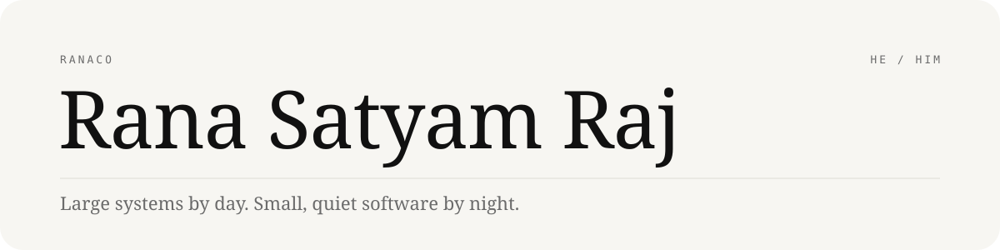

<picture>
  <source media="(prefers-color-scheme: dark)" srcset="assets/header-dark.svg">
  
</picture>

 

By day I build large, loud systems: the payment rails, ledger and key management [CodeDecoders](https://codedecoders.io) runs on, since 2022. That work is private.

By night I build small, quiet software, mostly for things I own. Each of these started as an itch with a device that wouldn't behave.

<i>Now: zInk 1.0.41 in closed beta; porting it to the Razr Fold.</i>

 

<b>SIDE PROJECTS</b>

| | | |
|:--|:--|--:|
| [**zInk**](https://github.com/Ranaco/zink) | A calm, e-ink-style home for the Motorola Razr's cover screen. Closed beta on Play · [zink.ranax.co](https://zink.ranax.co) | Kotlin |
| [**exCover**](https://github.com/Ranaco/exCover) | Animated GIF wallpapers for the Razr's cover home and lock screens. No root. | Java |
| [**Wheel**](https://github.com/Ranaco/wheel) | Your phone as a steering wheel and pedals for PC racing games; the PC sees an Xbox 360 controller. | Kotlin · Python |
| [**Hermit**](https://github.com/Ranaco/hermit) | A key-management system with versioned secrets and audit logging. On npm as @hermit-kms/cli. | TypeScript |
| [**Kai**](https://github.com/Ranaco/kai) | A self-hosted tunnelling client that embeds FRP. An ngrok you own. | Go |
| [**CMF Watch OS**](https://github.com/Ranaco/cmf-watch-pro-2-os) | A thin-client OS for the CMF Watch Pro 2 on Zephyr and LVGL. | C |
| [**Themis**](https://github.com/Ranaco/themis) | A VS Code extension that holds a PR to a team checklist before it opens. | TypeScript |

 

<b>WRITING</b>

One rule runs through both: exact or not at all. The first piece is about what happened the one time we rounded.

[The Sneaky Cost of Precision](https://medium.com/@rana.co/the-sneaky-cost-of-precision-how-currency-conversion-can-keep-a-team-up-all-night-b7c23360d1fa) · [From Bob's Notebook to Blockchain](https://medium.com/@rana.co/from-bobs-notebook-to-blockchain-demystifying-distributed-ledgers-4c4ffd4c4bd4)

 

<b>ELSEWHERE</b>

[ranax.co](https://ranax.co) · [LinkedIn](https://www.linkedin.com/in/ranaco) · ranasatyamraj@gmail.com
